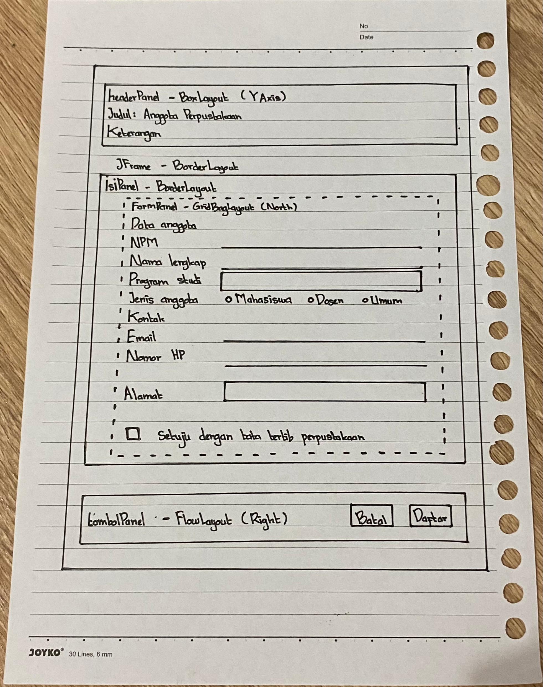
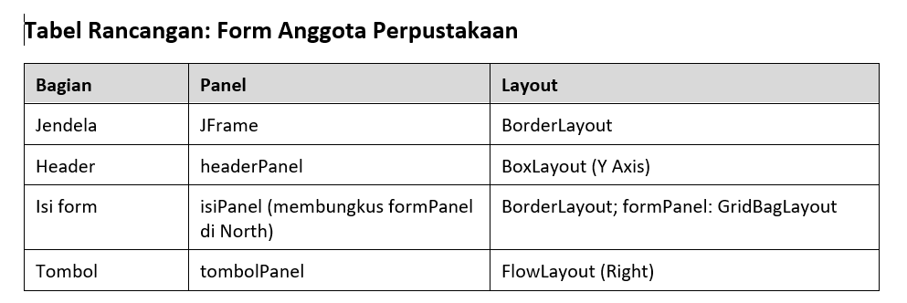
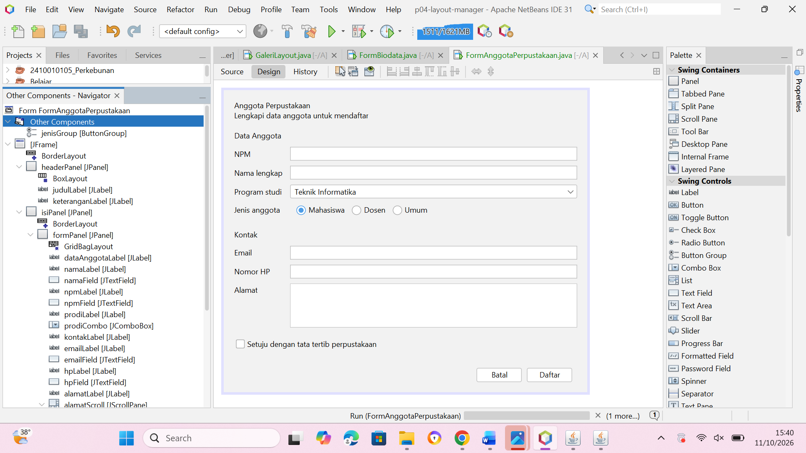
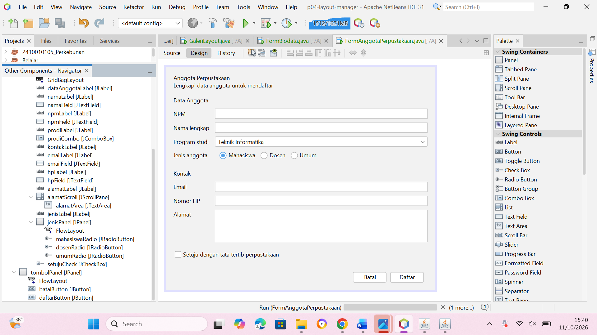
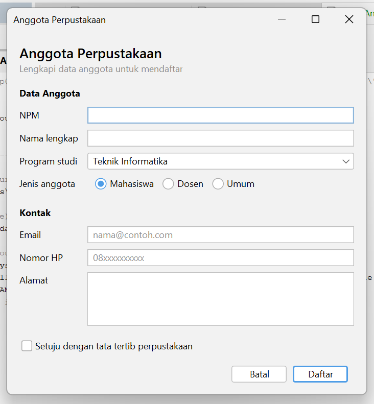
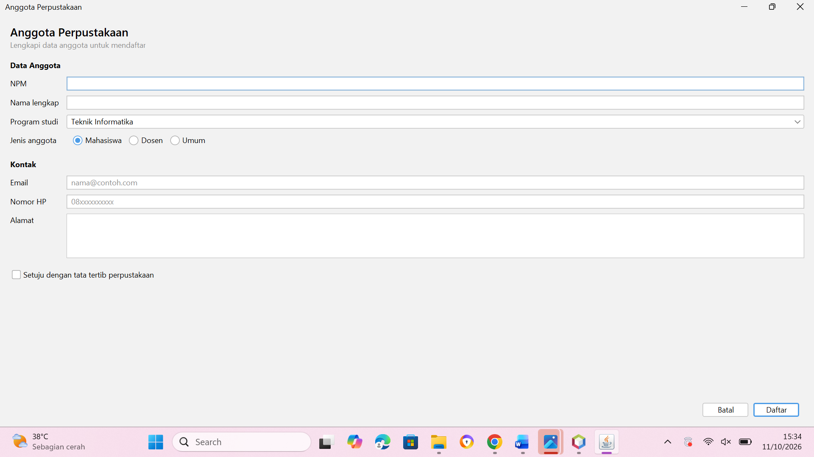

# P04 Layout Manager dan Desain Form

Nama: Nabila Adhelia
NPM: 2410010105
Mata kuliah: Pemrograman Berbasis Objek 2

Proyek ini berisi tiga form Swing yang dibuat dengan JFrame Form dan layout manager: `GaleriLayout`, `FormBiodata`, dan `FormAnggotaPerpustakaan`.

## Jawaban pertanyaan refleksi

**1. Mengapa Null Layout dan Absolute Layout sebaiknya dihindari?**

Null Layout dan Absolute Layout menaruh komponen di posisi dan ukuran piksel yang tetap. Akibatnya tampilan tidak ikut menyesuaikan saat ukuran jendela diubah, dan teks bisa terpotong kalau skala layarnya berbeda. Absolute Layout juga memerlukan library tambahan dari NetBeans, jadi aplikasinya sulit dijalankan di komputer lain.

**2. Jelaskan perbedaan perilaku FlowLayout dan GridLayout saat jendela dilebarkan.**

FlowLayout mempertahankan ukuran asli tiap komponen. Kalau jendela tidak cukup lebar, komponen yang tidak muat pindah ke baris berikutnya. GridLayout membagi ruang menjadi sel-sel yang sama besar, jadi saat jendela dilebarkan semua komponen ikut melebar bersamaan.

**3. Apa fungsi Weight X dan Fill pada constraint GridBagLayout?**

Weight X mengatur pembagian sisa lebar ke tiap kolom. Kolom isian diberi 1.0 supaya menyerap sisa lebar, sedangkan kolom label 0.0 supaya lebarnya tetap. Fill membuat komponen memenuhi seluruh selnya. Dengan Fill Horizontal, kotak isian mengisi penuh lebar kolomnya.

**4. Mengapa formPanel dibungkus isiPanel dan diletakkan di North?**

Supaya baris-baris form tetap menempel di atas saat jendela ditinggikan. Pada BorderLayout, area Center mengambil seluruh sisa ruang, sedangkan area North hanya setinggi isinya. Kalau formPanel ditaruh langsung di Center, ia ikut ditarik setinggi jendela dan barisnya jadi renggang.

**5. Sebutkan dua prinsip desain yang Anda terapkan dan tunjukkan buktinya.**

- Keselarasan: label dan isian tersusun di dua kolom yang rapi sehingga membentuk garis lurus dan mudah dibaca dari atas ke bawah. Buktinya ada di tangkapan layar ukuran awal dan saat dilebarkan.
- Kedekatan: isian yang berkaitan dikelompokkan dan diberi judul bagian, yaitu "Data Anggota" dan "Kontak". Buktinya terlihat di tangkapan layar yang sama.

## Deklarasi penggunaan AI

Saya menggunakan Claude dalam pengerjaan tugas ini untuk:

1. Memandu langkah-langkah pengerjaan modul. Karena saya belum terlalu menguasai materi layout manager dan penggunaan GUI Builder, saya meminta Claude menjelaskan langkah-langkah di modul dengan lebih rinci, bahkan berulang kali sampai saya paham. Penjelasan itu saya pakai sebagai pendamping modul, lalu saya kerjakan sendiri di NetBeans.
2. Membantu memeriksa pekerjaan saya. Saya menyadari kadang kurang teliti, jadi saya mengirim tangkapan layar Navigator dan hasil form agar Claude bisa membantu melihat hal-hal kecil yang mungkin terlewat.
3. Membantu merapikan kalimat jawaban eksperimen dan pertanyaan refleksi, termasuk penjelasan teknisnya. Semua eksperimen saya jalankan sendiri dan hasilnya saya lihat sendiri di layar. Claude membantu menyusun hasil itu menjadi kalimat yang lebih jelas. 

Semua form dibuat, dijalankan, dan diuji sendiri di NetBeans.

## Saran dari teman (Tahap 4)

| No | Pemeriksaan | Ya atau Belum |
|---|---|---|
| 1 | Label singkat, jelas, dan sejajar | Ya |
| 2 | Isian dikelompokkan dengan judul bagian | Ya |
| 3 | Placeholder dipakai untuk isian yang punya format | Ya |
| 4 | Komponen sesuai jenis data | Ya |
| 5 | Tombol utama menonjol dan berada di kanan bawah | Ya |
| 6 | Jarak antar komponen konsisten | Ya |
| 7 | Form tetap rapi saat jendela dilebarkan dan ditinggikan | Ya |
| 8 | Tampilan dibuat dengan JFrame Form dan layout manager, bukan Null Layout atau Absolute Layout | Ya |

Saran perbaikan dari novia:

1. Antara bagian "Data Anggota" dan "Kontak" hanya dipisahkan judul tebal, bisa ditambah jarak atau garis pemisah agar lebih jelas.

## Jawaban eksperimen

### Praktikum 2: GaleriLayout

**Eksperimen 1: flowPanel, Alignment Center**

Tombol pindah dari kiri ke tengah. Saat jendela dikecilkan, tombol yang tidak muat turun ke baris berikutnya dan tiap baris tetap di tengah. Baris yang berubah di `initComponents()` adalah `flowPanel.setLayout(new java.awt.FlowLayout(java.awt.FlowLayout.CENTER, 8, 8));`, yaitu `FlowLayout.LEFT` menjadi `FlowLayout.CENTER`.

**Eksperimen 2: gridPanel, Rows 0 dan Columns 2**

Terbentuk 5 baris. Empat baris pertama berisi 2 tombol, baris kelima hanya tombol 9. Rows 0 berarti jumlah baris dihitung otomatis: 9 tombol dibagi 2 kolom dibulatkan ke atas menjadi 5.

**Eksperimen 3: boxPanel, maximumSize dan Vertical Strut**

Dengan maximumSize 32767 x 23, tombol melebar memenuhi lebar panel dan tingginya tetap. Hal ini karena BoxLayout mengikuti ukuran maksimum komponen. Vertical Strut 8 piksel memberi jarak tetap antar tombol.

### Praktikum 4: FormBiodata

**Eksperimen 1: Weight X namaField menjadi 0.0**

Kotak Nama lengkap tetap ikut melebar. Sisa lebar dibagi per kolom, dan kolom isian masih punya Weight X 1.0 dari komponen lain, sementara Fill `namaField` masih Horizontal.

**Eksperimen 2: Direction formPanel dari North menjadi Center**

Isi form bergeser ke tengah dengan ruang kosong di atas dan di bawah. Pada Center, `formPanel` ditarik setinggi `isiPanel`, sedangkan pada North hanya setinggi isinya. Inilah alasan `formPanel` dibungkus `isiPanel` dan diletakkan di North.

**Eksperimen 3: Menghapus setMinimumSize(getSize())**

Isi form rusak lebih dulu: kotak isian menyempit dan label terpotong, lalu header dan tombol ikut terpotong. Tanpa ukuran minimum, jendela boleh lebih kecil dari total ukuran minimum komponennya.

Foto Sketsa dan Tabel Rancangan

### 1. Foto Sketsa

### 2. Tabel Rancangan

## Screenshot Design FormAnggotaPerpustakaan

### Bagian 1

### Bagian 2

## Screenshot Ukuran Form

### 1. Tampilan Awal

### 2. Tampilan Setelah Dilebarkan

