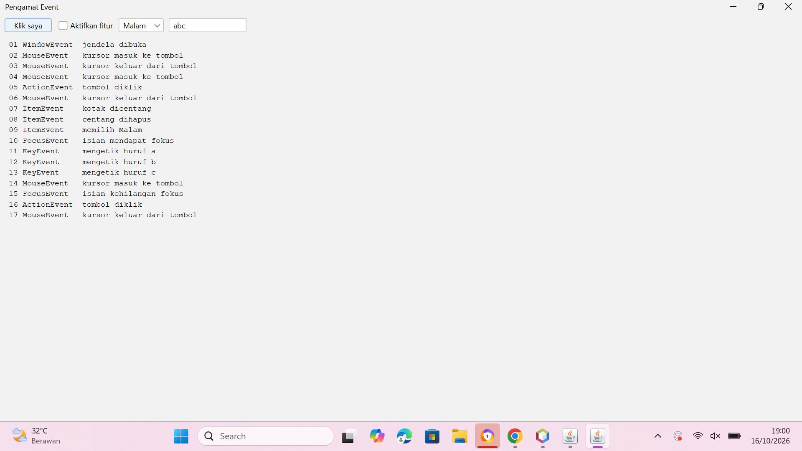
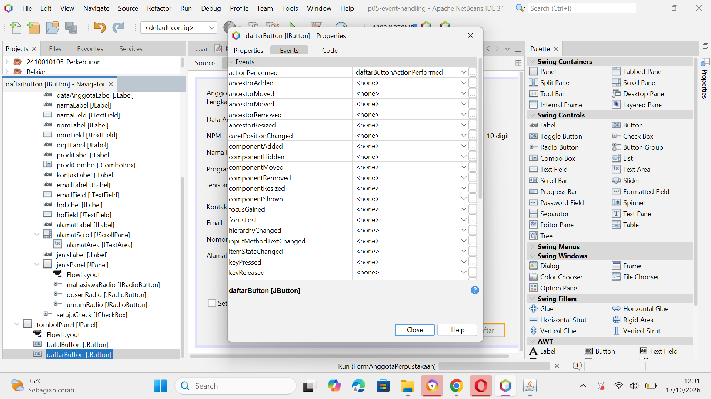
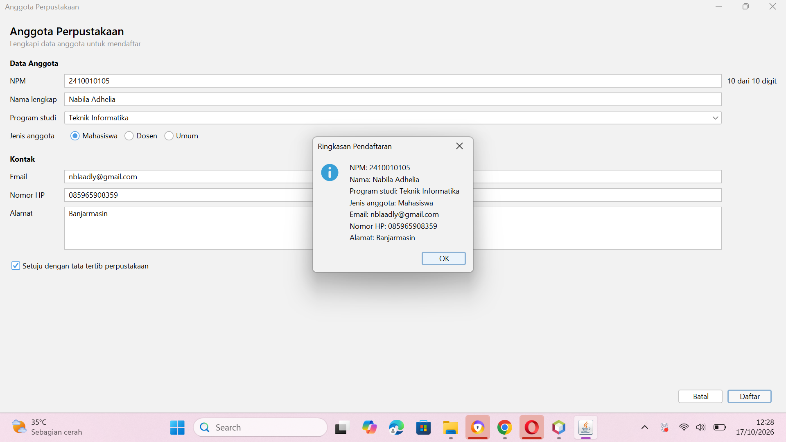
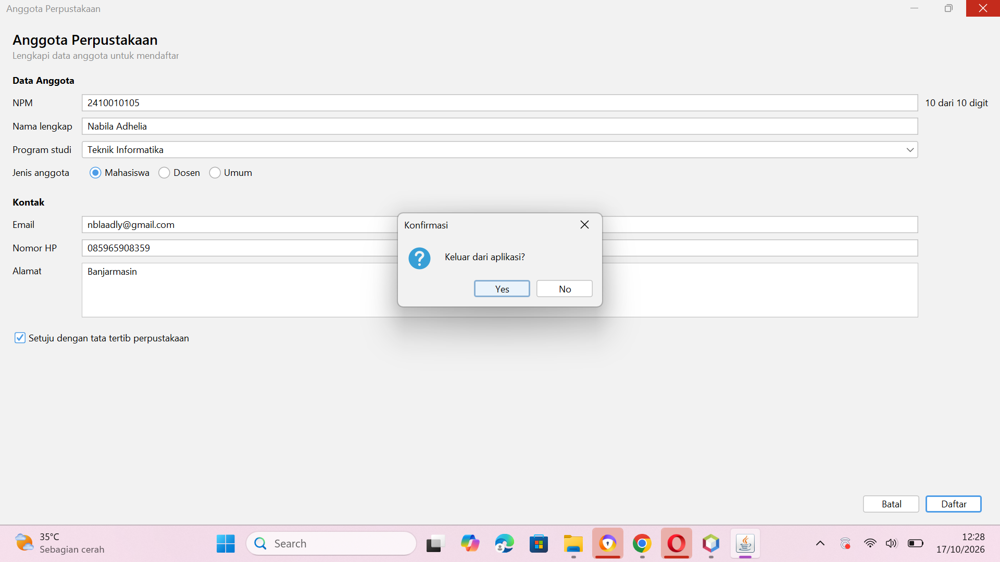

# P05 Event Handling

Nama: Nabila Adhelia
NPM: 2410010105

## Tabel Pengamatan Praktikum 2

| No | Tindakan | Event yang tercatat |
|----|----------|---------------------|
| 1 | Arahkan kursor ke tombol, lalu jauhkan | MouseEvent mouseEntered (kursor masuk ke tombol), MouseEvent mouseExited (kursor keluar dari tombol) |
| 2 | Klik tombol Klik saya | MouseEvent mouseEntered, ActionEvent actionPerformed (tombol diklik), MouseEvent mouseExited |
| 3 | Centang lalu hapus centang Aktifkan fitur | ItemEvent itemStateChanged (kotak dicentang), ItemEvent itemStateChanged (centang dihapus) |
| 4 | Ganti pilihan dari Pagi menjadi Malam | ItemEvent itemStateChanged (memilih Malam), hanya 1 baris |
| 5 | Klik isian, lalu ketik kata "abc" | FocusEvent focusGained (isian mendapat fokus), KeyEvent keyTyped 3 kali (huruf a, b, c) |
| 6 | Klik tombol setelah mengetik di isian | MouseEvent mouseEntered, FocusEvent focusLost (isian kehilangan fokus), ActionEvent actionPerformed (tombol diklik), MouseEvent mouseExited |

## Jawaban Eksperimen Praktikum 3

1. Pesan "item berubah" tercetak 2 kali setiap pilihan diganti. `itemStateChanged` dipanggil sekali untuk pilihan lama (DESELECTED) dan sekali untuk pilihan baru (SELECTED). Karena itu aksi perlu diperiksa dengan `evt.getStateChange() == ItemEvent.SELECTED` agar hanya berjalan sekali.

2. Hasil terlambat satu karakter karena `keyPressed` dipanggil saat tombol baru ditekan, sebelum karakter masuk ke isian, sehingga `getText()` masih membaca isi sebelumnya. Pada `keyReleased`, karakter sudah masuk sehingga `getText()` membaca isi terbaru.

3. Di Output muncul `java.lang.NumberFormatException: For input string: "a"` beserta stack trace, karena `Double.parseDouble` tidak bisa mengubah huruf menjadi angka dan tidak ada `catch`. Aplikasi tetap berjalan tapi pengguna tidak mendapat umpan balik. `try` dan `catch` diperlukan untuk menampilkan "Masukkan angka yang valid".

## Jawaban Eksperimen Praktikum 4

1. Pesan "kali" tercetak 2 kali setiap tombol x diklik. `kaliButton` punya dua listener: satu dari event handler GUI Builder (dipasang NetBeans di `initComponents()`) dan satu dari lambda di konstruktor. Satu tombol sebaiknya hanya memakai satu cara agar aksinya tidak berjalan dua kali.

2. Tab Design: menambah Button `modButton` (text `%`) di `operatorPanel`, mengubah Columns GridLayout `operatorPanel` dari 4 menjadi 5, dan membuat event `actionPerformed` lewat Events. Tab Source: mengisi `modButtonActionPerformed` dengan `hitung('%');`, menambah `case '%' -> a % b;` pada `switch` di `hitung`, dan memperluas pemeriksaan pembagi nol menjadi `(operator == '/' || operator == '%') && b == 0`.

3. Kursor berada di isian pertama karena method `hapus` memanggil `angka1Field.requestFocusInWindow()`, yang mengembalikan fokus keyboard ke isian pertama setelah tombol Hapus diklik.

## Latihan Mandiri: Peta Event FormAnggotaPerpustakaan

| Komponen | Menu Events | Aksi |
|----------|-------------|------|
| Kotak centang setujuCheck | Item: itemStateChanged | Tombol Daftar hanya aktif jika dicentang |
| Tombol batalButton | Action: actionPerformed | Kosongkan semua isian dan kembalikan fokus ke NPM (lewat method kosongkanIsian) |
| Tombol daftarButton | Action: actionPerformed | Tampilkan ringkasan data dengan JOptionPane |
| Isian npmField | Key: keyReleased | Label digitLabel menampilkan jumlah digit, misalnya "8 dari 10 digit" |
| Form (JFrame) | Window: windowClosing | Minta konfirmasi sebelum aplikasi ditutup |

Pengaturan Properties: `defaultCloseOperation` form = DO_NOTHING, `enabled` tombol Daftar = tidak dicentang.

### Screenshot

## Jawaban Pertanyaan Refleksi

1. **Peran sumber event, object event, dan listener.**
Sumber event adalah komponen tempat kejadian terjadi, misalnya `daftarButton` yang diklik. Object event berisi informasi kejadian itu, misalnya `ActionEvent evt` pada `daftarButtonActionPerformed(evt)`. Listener adalah object yang menjalankan tanggapan dan didaftarkan lewat `addActionListener()`. Di proyek ini NetBeans membuat listener di `initComponents()` yang memanggil method `daftarButtonActionPerformed`.

2. **Mengapa KeyListener tidak dapat ditulis dengan lambda, dan bagaimana NetBeans mengatasinya.**
Lambda hanya bisa dipakai untuk interface dengan satu method abstract (interface fungsional). `KeyListener` punya tiga method (`keyPressed`, `keyReleased`, `keyTyped`), sehingga tidak bisa ditulis dengan lambda dan mewajibkan semua method ditulis. Saat kita memilih event `keyReleased`, NetBeans memakai kelas adapter `KeyAdapter` yang menyediakan implementasi kosong untuk semua method, sehingga hanya `keyReleased` yang perlu ditulis.

3. **Keuntungan memisahkan KonverterSuhu dari form KonversiSuhu.**
Logika perhitungan menjadi terpisah dari tampilan, sehingga mudah dipakai ulang di form lain, mudah diuji tanpa membuka GUI (Pertemuan 13), dan kode form lebih pendek karena hanya membaca isian, memanggil `KonverterSuhu`, lalu menampilkan hasil.

4. **Mengapa aksi pada itemStateChanged perlu memeriksa ItemEvent.SELECTED.**
`itemStateChanged` pada Combo Box dipanggil dua kali setiap pilihan diganti: sekali untuk pilihan lama (DESELECTED) dan sekali untuk pilihan baru (SELECTED). Tanpa pemeriksaan `evt.getStateChange() == ItemEvent.SELECTED`, aksi berjalan dua kali. Hal ini terbukti pada Eksperimen 1 Praktikum 3, pesan tercetak 2 kali.

5. **Kapan memakai event handler GUI Builder, lambda, atau method reference.**
Event handler GUI Builder (lewat menu Events) adalah cara utama pada JFrame Form karena tersimpan di file `.form` dan mudah dilacak, misalnya `tambahButtonActionPerformed`. Lambda dipakai untuk aksi singkat yang ditulis di konstruktor setelah `initComponents()`, misalnya `kaliButton.addActionListener(e -> hitung('x'))`. Method reference dipakai ketika aksinya sudah ditulis sebagai method tersendiri, misalnya `hapusButton.addActionListener(this::hapus)`. Satu tombol cukup memakai satu cara agar aksinya tidak berjalan dua kali.

## Deklarasi Penggunaan AI

Saya menggunakan Claude (Anthropic) sebagai alat bantu untuk memandu langkah pengerjaan praktikum, membantu membaca pesan error dan garis merah di NetBeans, memeriksa hasil screenshot, serta membantu menyusun draf jawaban eksperimen, pertanyaan refleksi, dan README. Kode dijalankan dan diuji sendiri di NetBeans, dan hasil pengamatan (tabel Praktikum 2 dan jumlah pesan pada eksperimen) diambil dari aplikasi yang saya jalankan sendiri.