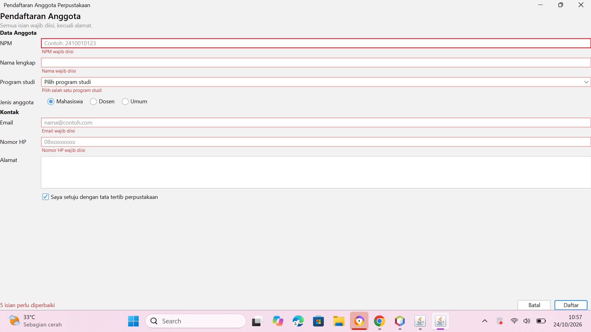
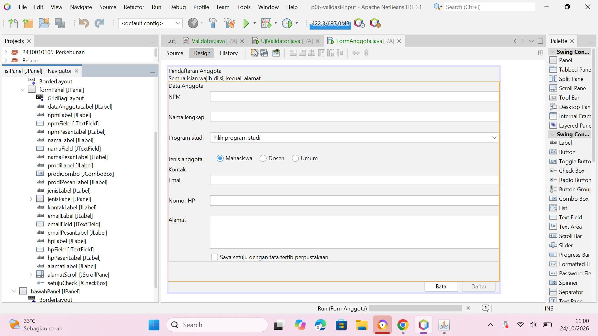
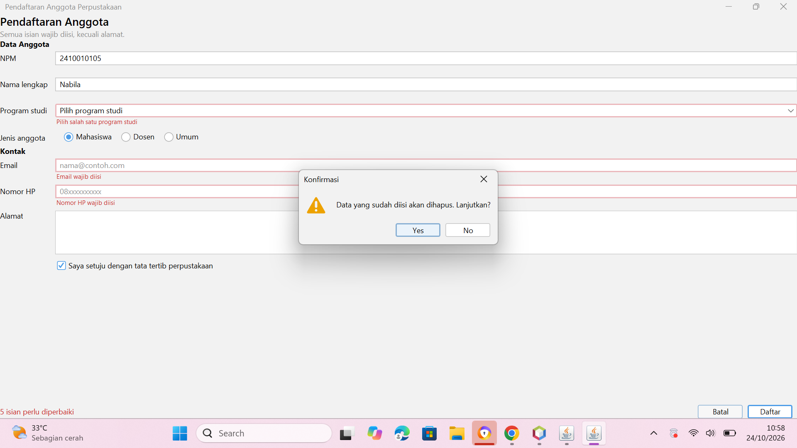
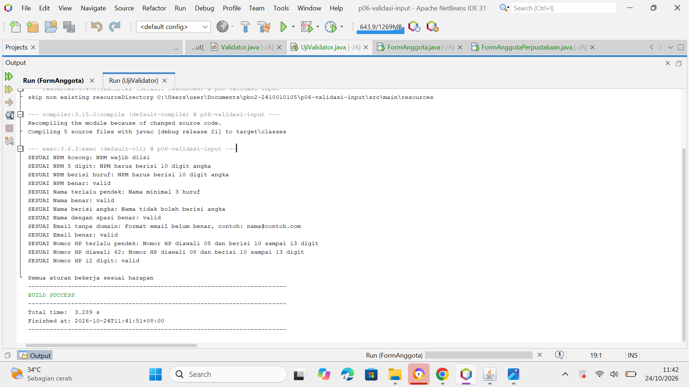
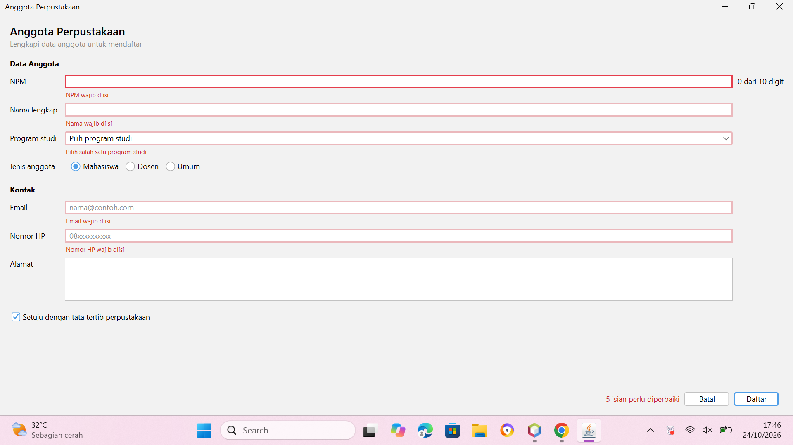
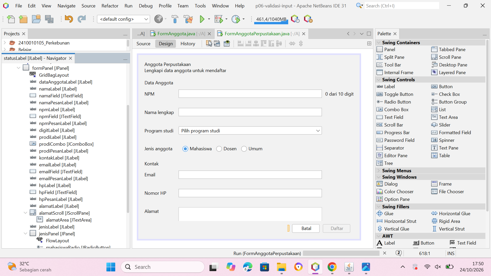
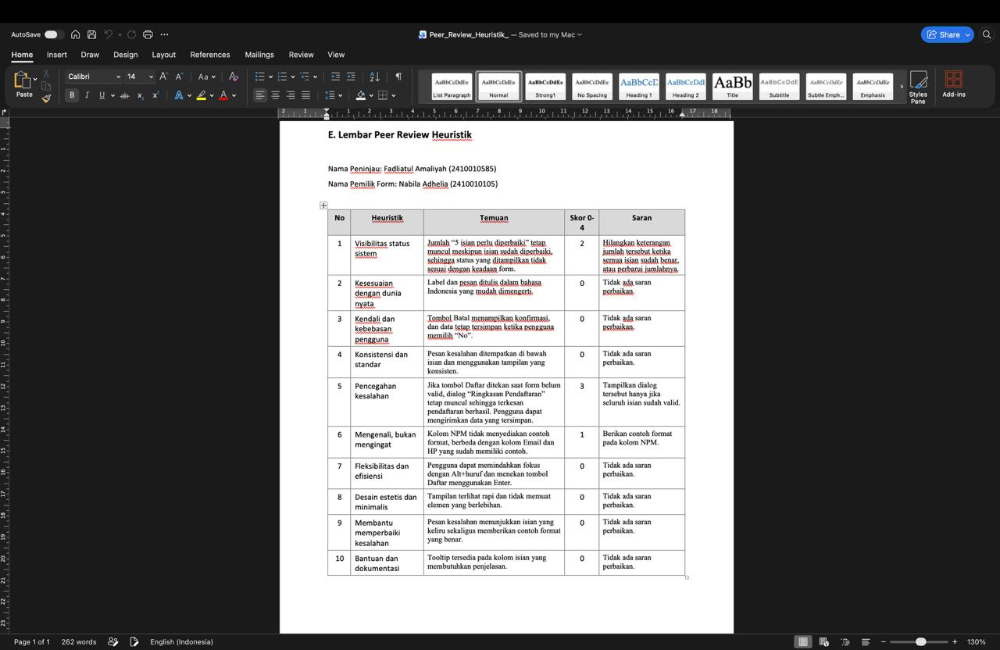
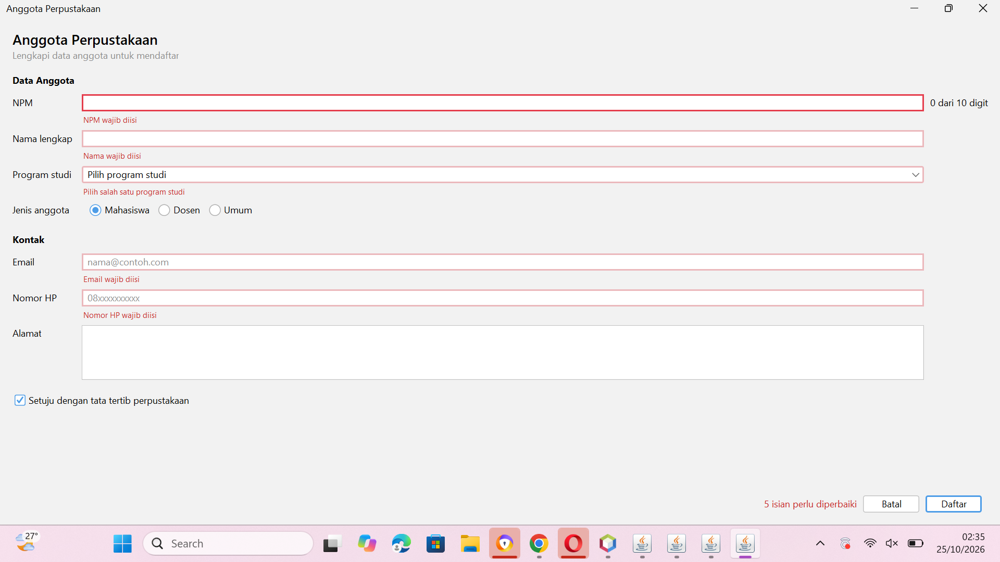
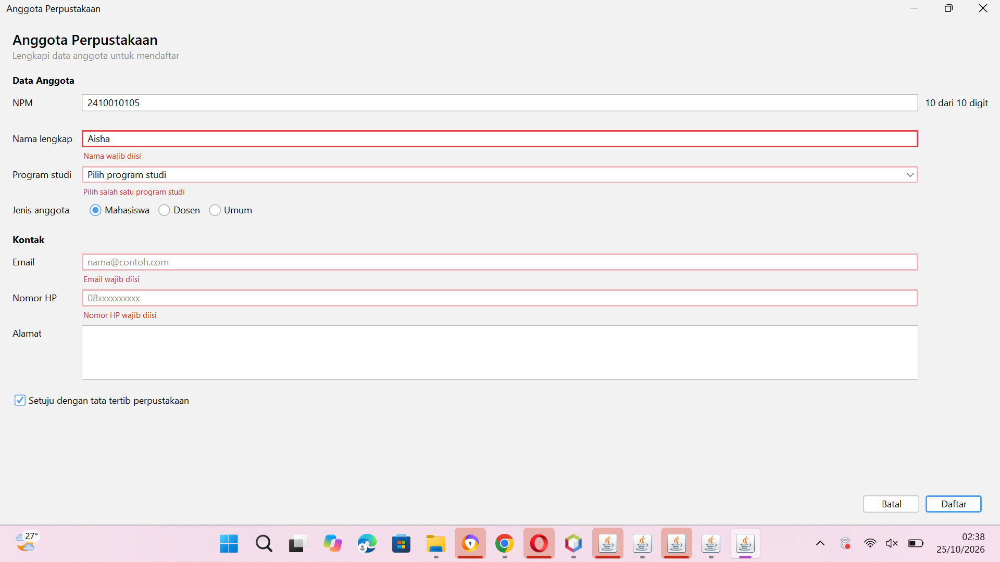

# P06 Validasi Input dan Kegunaan

Nama: Nabila Adhelia
NPM: 2410010105

## Praktikum 2: Hasil UjiValidator

Semua baris keluaran UjiValidator bertanda SESUAI dan muncul tulisan "Semua aturan bekerja sesuai harapan".

## Praktikum 4: Form contoh FormAnggota

### Tangkapan layar form dengan pesan kesalahan

### Tangkapan layar jendela Navigator yang memperlihatkan label pesan

### Tangkapan layar konfirmasi Batal

### Jawaban Eksperimen Praktikum 4

| No | Eksperimen | Hasil dan penjelasan |
|----|-----------|----------------------|
| 1 | Ketik huruf pada isian NPM | Huruf tidak muncul di isian. Penyebabnya baris `evt.consume();` pada `npmFieldKeyTyped`, yang dijalankan karena `!Character.isDigit(evt.getKeyChar())` bernilai true. |
| 2 | Isi email `siti@`, lalu tekan Tab | Pesan kesalahan muncul saat Tab ditekan, yaitu ketika isian kehilangan fokus (`focusLost`), bukan saat mengetik. |
| 3 | Klik isian Nama tanpa mengetik, lalu Tab | Tidak ada pesan, karena `namaFieldFocusLost` hanya memeriksa jika isian tidak kosong (`!isBlank()`). Isian kosong baru diperiksa saat Daftar diklik, agar pengguna tidak langsung diberi pesan hanya karena melewati isian. |
| 4 | Centang persetujuan, klik Daftar dengan form kosong | Isian NPM mendapat fokus, karena `daftar()` memanggil `salah.get(0).requestFocusInWindow()` untuk kesalahan pertama. |
| 5 | Tekan Alt+N | Isian Nama lengkap mendapat fokus. Diatur oleh properti `displayedMnemonic` (N) dan `labelFor` (namaField) pada `namaLabel`. |
| 6 | Isi beberapa isian, klik Batal, pilih No | Data tetap ada, karena `batal()` langsung `return` jika jawaban bukan YES. |

## Latihan Mandiri: FormAnggotaPerpustakaan

Aturan validasi NPM, nama, email, dan nomor HP dikumpulkan di kelas `Validator`. Aturan baru "nama tidak boleh berisi angka" ditambahkan di `Validator.nama` dan diuji di `UjiValidator`.

### Hasil UjiValidator (13 baris SESUAI)

### Form dengan pesan kesalahan

### Navigator yang memperlihatkan label pesan

## Lembar Peer Review

Lembar peer review dari teman (peninjau: Fadliatul Amaliyah, 2410010585).

## Tabel Temuan Peer Review

| Temuan | Skor | Perbaikan | Commit |
|--------|------|-----------|--------|
| Dialog "Ringkasan Pendaftaran" muncul saat Daftar diklik walau form belum valid, seolah pendaftaran berhasil | 3 | Hapus sisa kode P05 di `daftarButtonActionPerformed`, sisakan `daftar();` | `a77495b` |
| Tulisan "5 isian perlu diperbaiki" tidak berubah setelah isian dibetulkan | 2 | Di method `tandai`, kosongkan `statusLabel` saat isian sudah benar | `edc8e37` |
| Kotak NPM tanpa contoh format | 1 | Tambah placeholder NPM di konstruktor | `cad1def` |

### Bukti tampilan sebelum dan sesudah perbaikan

## Jawaban Pertanyaan Refleksi

1. **Mengapa aturan validasi dipisahkan ke kelas Validator?**
Aturan validasi tidak bergantung pada tampilan, sehingga dapat diuji tanpa membuka GUI (lewat UjiValidator), dipakai ulang di form lain, dan diubah di satu tempat. Event handler juga menjadi pendek karena hanya memanggil `Validator` lalu menampilkan hasilnya.

2. **Mengapa isian kosong tidak langsung ditandai merah saat hanya dilewati?**
Pengguna belum sempat mengisi, sehingga tanda merah terasa seperti teguran yang tidak adil. Karena itu `focusLost` hanya memeriksa isian yang tidak kosong (`!isBlank()`), dan isian kosong baru diperiksa saat tombol Daftar diklik.

3. **Tiga heuristik Nielsen yang diterapkan beserta buktinya.**
- Pencegahan kesalahan: NPM dan nomor HP hanya menerima angka lewat `evt.consume()` di `keyTyped`, dan tombol Daftar nonaktif sampai persetujuan dicentang (lihat `latihan-kesalahan.png`).
- Membantu memperbaiki kesalahan: pesan menyebut isian yang salah dan memberi contoh, misalnya "Format email belum benar, contoh: nama@contoh.com", ditampilkan tepat di bawah isian (lihat `latihan-kesalahan.png`).
- Kendali dan kebebasan pengguna: tombol Batal meminta konfirmasi sebelum menghapus data dan tetap menyimpan data jika memilih No (lihat `form-konfirmasi-batal.png`).

4. **Mengapa pesan kesalahan tidak boleh hanya berupa warna merah?**
Sebagian pengguna buta warna sehingga tidak dapat membedakan merah dari warna lain. Karena itu kesalahan ditandai dengan teks pesan yang jelas di bawah isian dan ringkasan "N isian perlu diperbaiki", bukan hanya garis merah.

5. **Temuan peer review yang paling bermanfaat dan alasannya.**
Temuan skor 3, yaitu dialog "Ringkasan Pendaftaran" yang muncul walau form belum valid. Sisa kode P05 itu membuat pengguna mengira pendaftaran berhasil padahal datanya salah, sehingga validasi yang sudah dibuat tidak ada gunanya. Temuan ini paling bermanfaat karena saya tidak melihatnya sendiri saat menguji, dan baru terlihat setelah form dicoba orang lain dengan data salah.

## Deklarasi Penggunaan AI

Saya menggunakan Claude (Anthropic) sebagai alat bantu untuk memandu langkah pengerjaan, membaca garis merah dan pesan error di NetBeans, memeriksa tangkapan layar. Kode dijalankan dan diuji sendiri di NetBeans, dan hasil eksperimen diambil dari aplikasi yang saya jalankan sendiri.